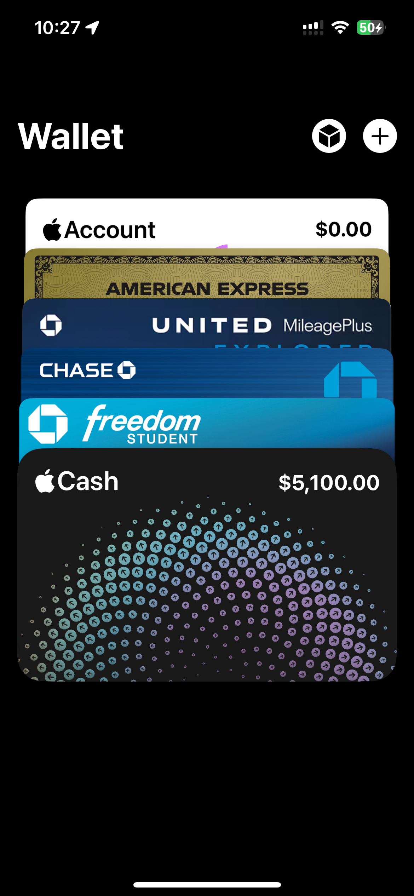
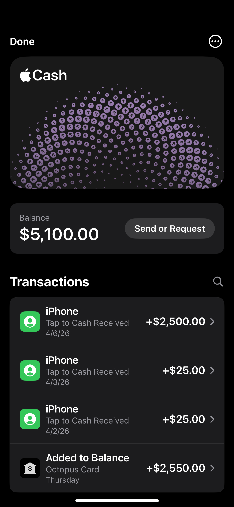
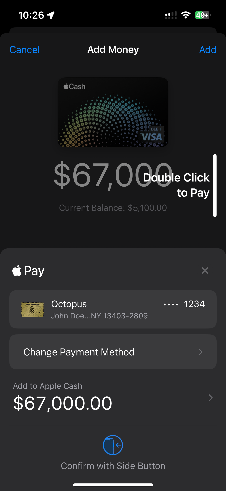
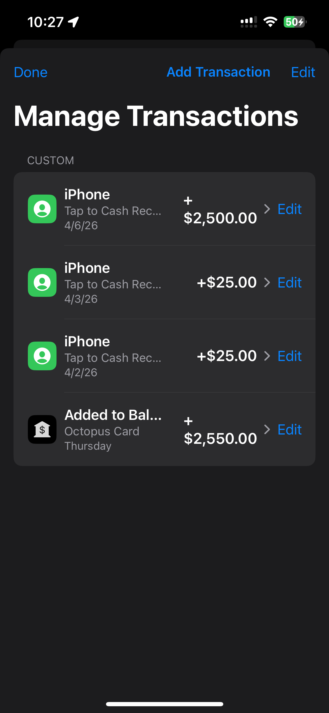
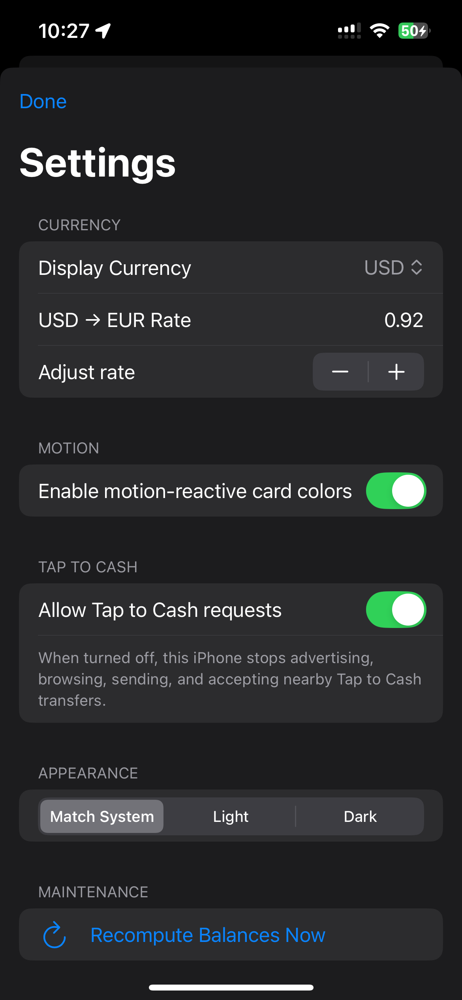

## Apple Wallet Clone

I’m new to programming in Swift, and for the past few months I’ve been working on building a clone of the Apple Wallet app because I couldn’t think of what else to build.

### Features

- Motion support for the Cash card

- Motion support for Apple Account / gc visuals

- Partial add card flow

- Partial Tap to Cash flow

- Add money from other cards via Apple Pay

- Transfer money to a bank

- Hidden transaction editor by long pressing Transactions on the card details screen

- Hidden settings menu by long pressing Wallet on the home screen

I will not open source this project but I am willing to share builds.

  
  
  
  
  

